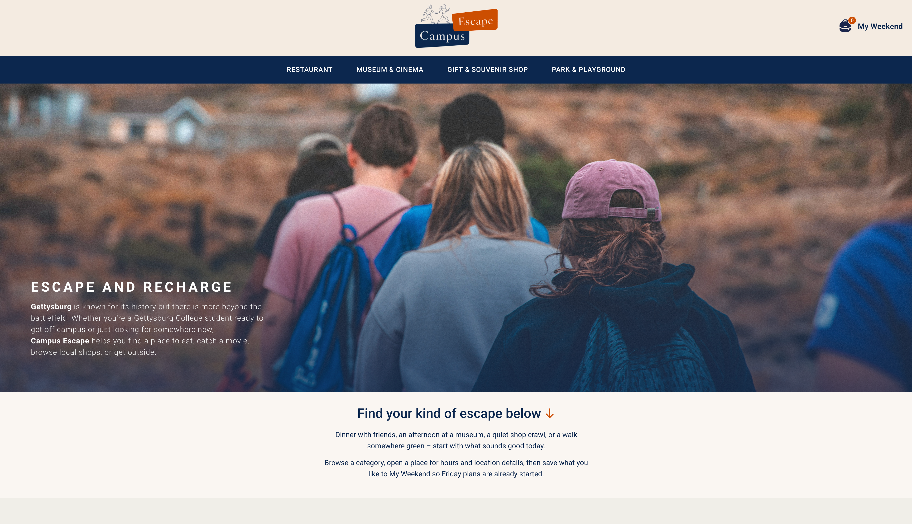
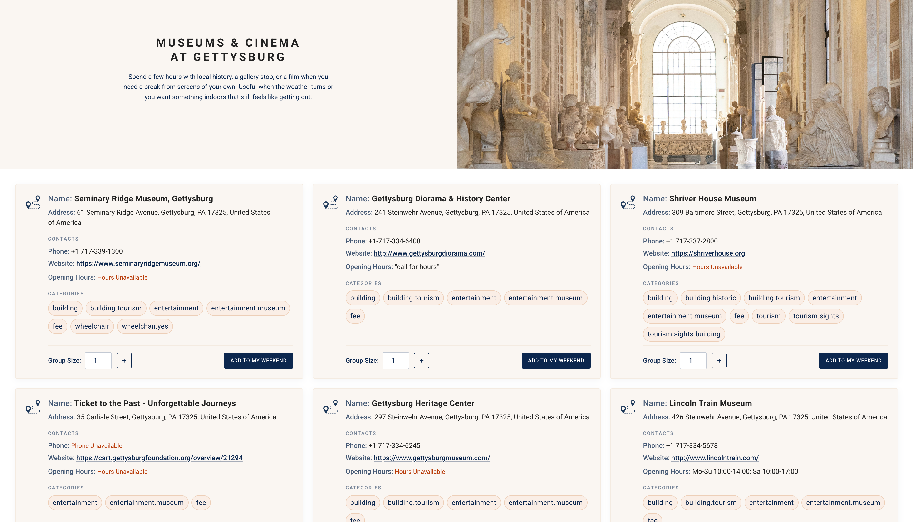
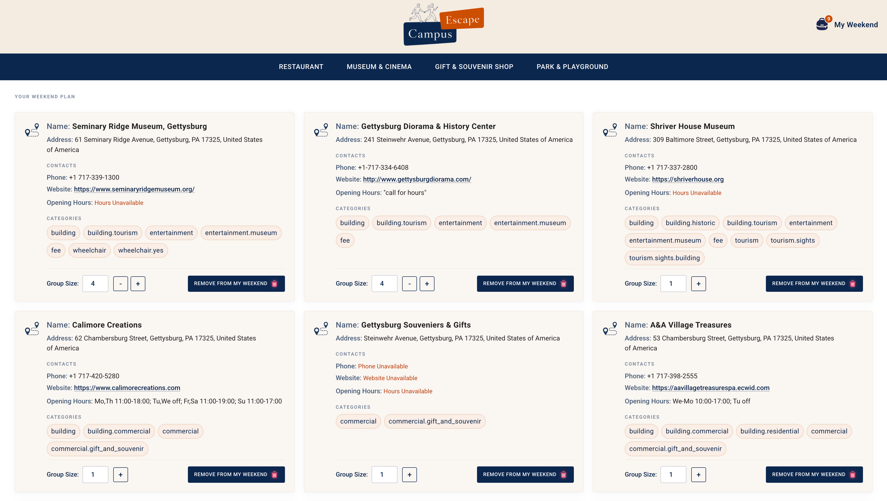

# Campus<span style="font-weight: 800; color: #cc4e01;">Escape</span>

**Campus Escape** is a browser-based weekend planner for the little historic town in Pennsylvania, **Gettysburg**. You can browse off-campus places to eat, catch a film or museum stop, shop local, or get outside, then build a small **My Weekend** list with a group size for each stop. This project is aimed especially at students (and anyone visiting) who want ideas without endless tab-hopping. Start on the home story, pick a category, add what looks good, and open the cart when you are ready to tighten the plan.

There is no backend. Everything runs in the browser: **Vite** bundles **React**, **React Router**, and CSS modules, place cards come from the **Geoapify Places API**, and the weekend list lives in memory for the session — refresh and the cart clears. That is intentional for this learning project, not a production travel product with accounts or persistence.

This was built as part of **The Odin Project** curriculum (thanks to the TOP community), and incorporates a semi Gettysburg College theme. If you are reading the repo, you will see how **App** owns `myWeekend` and passes it through **Outlet** context, how **Category** loads places with **`useCategoryFetch`**, how **PlaceInfo** holds the shared place details so **ItemBrowse** and **ItemCart** can disagree on group-size and add/remove behavior without copying the whole card, and how **Checkout** just reads that same context to render the plan or an empty state. Hooks keep fetch and draft size out of the page components; tests sit next to the pieces that needed the most confidence.

### What’s on `main` (current code)

- **`App`** — logo, category nav, **CartButton**, footer; owns `myWeekend` / `setMyWeekend` and the Outlet context
- **`Home`** — full-bleed intro, category panels, closing CTA into the weekend plan
- **`Category`** — route param, header image, Geoapify list, maps features into browse cards
- **`ItemBrowse`** — category card: draft group size, add to weekend, selected/disabled state
- **`ItemCart`** — weekend card: edit size (blur / ±), remove with trash control
- **`PlaceInfo`** — shared name, address, contacts, hours, categories (and a slot for the people row)
- **`Checkout`** — empty message or the grid of cart items (`/weekend-plan`)
- **`CartButton`** — count + link to the weekend plan
- **Hooks** — `useCategoryFetch`, `useGroupSize`, `useMyWeekendContext`
- **`routes.jsx`** — home, `:category`, `weekend-plan`

<p align="center">
  
  &nbsp;&nbsp;
  
  &nbsp;&nbsp;
  
</p>

## Getting Started

### **Try it online**

**Live app:** [https://campusescape.vercel.app/](https://campusescape.vercel.app/) — opens in the browser; no account required. Needs network access for Geoapify.

### **Run it locally** (if you are cloning or tweaking the code)

You need **Node.js** and **npm** for the Vite dev server and production build.

#### **Prerequisites**

- **Node.js** (LTS recommended) and **npm**
- **Git** (only if you use `git clone` below; otherwise use GitHub **Code → Download ZIP**)
- Network access so category pages can reach the Geoapify Places API

#### Check that Git is installed (only if you clone)

```bash
git --version
```

#### **Installing**

##### 1. Clone this repository and open the project directory

```bash
git clone https://github.com/soikat27/campus-escape.git
```

```bash
cd campus-escape
```

##### 2. Install dependencies

```bash
npm install
```

> **API key note:** The demo Geoapify key is bundled in the client fetch URLs (same pattern as a class / portfolio demo). For your own fork, create a free key at [Geoapify](https://www.geoapify.com/) and swap it in — do not burn someone else’s quota.

#### **Running locally**

Start the development server (opens in the browser):

```bash
npm run dev
```

#### **Production build**

```bash
npm run build
```

Built files are written to `dist/` (gitignored). Preview the build with `npm run preview`, or let **Vercel** run the same build from the repo.

## Using the app

The same behavior applies on the [live demo](https://campusescape.vercel.app/) and when you run the dev server locally.

### Features

- **Home narrative** — Gettysburg-focused intro, category panels, path into My Weekend
- **Four categories** — restaurants, museums & cinema, gift & souvenir shops, parks & outdoors
- **Live place cards** — name, address, contacts, hours, categories from Geoapify (with honest “unavailable” copy when a field is missing)
- **Group size** — set how many people before you add; edit again from the cart
- **My Weekend cart** — add from browse, see a count on the cart control, open `/weekend-plan` to review
- **Remove** — drop a place from the plan when it no longer fits
- **Empty state** — clear message when the plan has nothing in it yet
- **Session-only cart** — no login; refresh starts the list over

### Usage

1. Open the app → skim Home → pick a category from the nav or a panel
2. Wait for places to load → set **Group Size** → **Add to My Weekend**
3. Open **My Weekend** → adjust sizes or **Remove from My Weekend** as needed
4. Jump categories anytime; selected places stay checked while this session lasts

### Upcoming features

- **Persist My Weekend** — optional `localStorage` (or similar) so a refresh does not wipe the plan

## Available Scripts

- `npm run dev` — Vite dev server
- `npm run build` — production build into `dist/`
- `npm run preview` — serve the production build locally
- `npm run lint` — ESLint
- `npm run test` — Vitest (watch); use `vitest --run` for a single pass

## Deployment

This project is set up to host on **Vercel** (or any static host that runs `npm run build` and serves `dist/`). Connecting the GitHub repo is enough: the host runs the build and serves the output. `dist/` stays out of git.

**Live site:** [https://campusescape.vercel.app/](https://campusescape.vercel.app/)

You could also host the same `dist/` output on Netlify, Cloudflare Pages, or GitHub Pages.

## Built with

- **React 19** — function components and hooks
- **Vite 8** — dev server and production bundle
- **React Router** — nested routes, Outlet context for the weekend list
- **CSS modules** — tokens, layout, Home / Category / item / Checkout styles
- **Roboto** — bundled variable font
- **Vitest** + **Testing Library** — component tests beside the UI
- [**Geoapify Places API**](https://www.geoapify.com/places-api/) — place search for the Gettysburg area

## Contributing

Contributions are welcome and appreciated. Open an issue or send a PR if you want to harden the cart, improve empty/error states, tighten tests, or teach me something I missed.

## Author

- **Soikat Saha** — design and implementation

## License

This project is licensed under the MIT License — see the [LICENSE](LICENSE) file for details.

## Acknowledgments

- Shoutout to the **Odin Project** community and curriculum for guidance on the shopping-cart / React path that shaped this.
- **[Geoapify](https://www.geoapify.com/)** – Places API powering the category lists; location data and geocoding products are theirs — this project only consumes the API for a student demo.
- **Gettysburg** as the setting — history is the backdrop; the app is about everyday escapes around town.
- Thanks to everyone who maintains solid **MDN** docs — fetch, forms, and the Constraint Validation API got plenty of use while group size was being sorted out.
